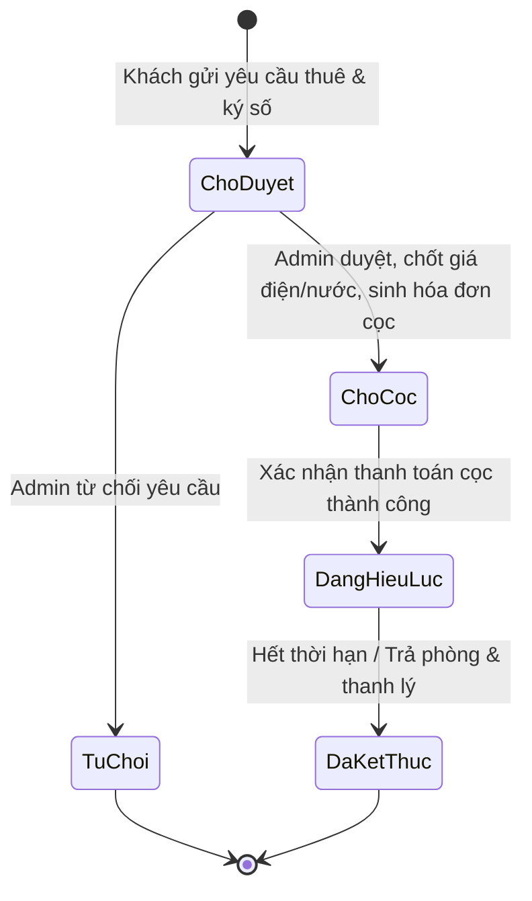
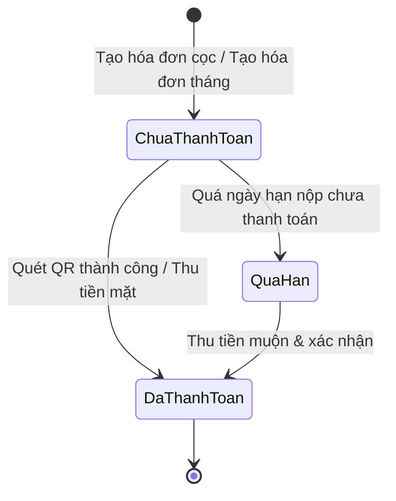
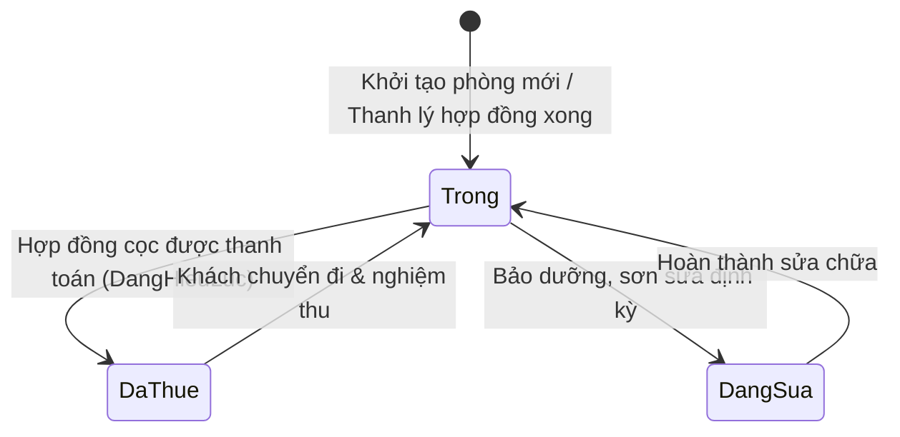
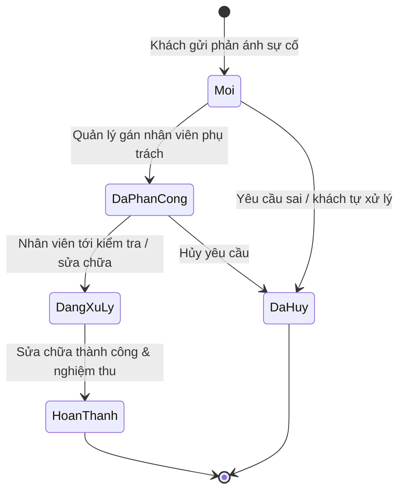
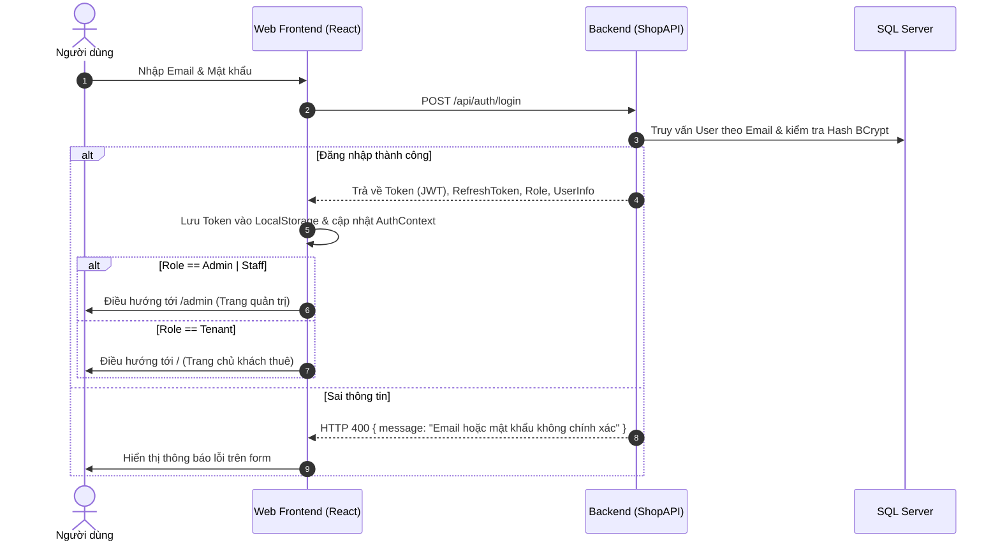
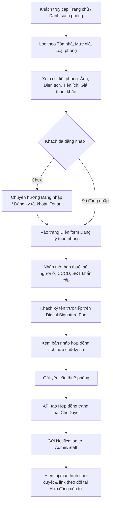
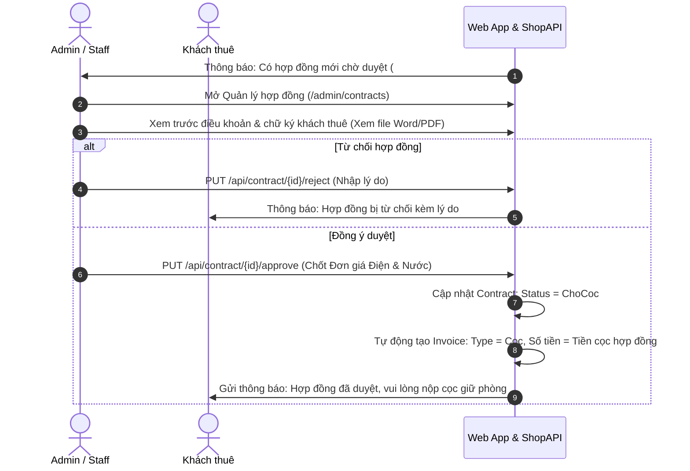
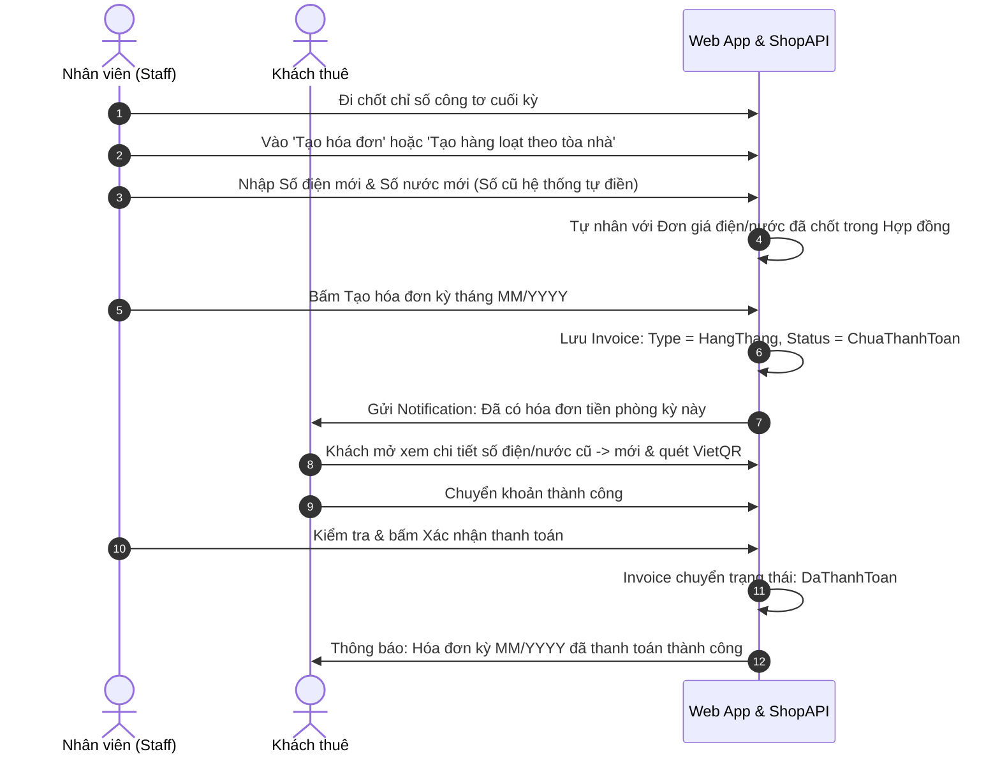
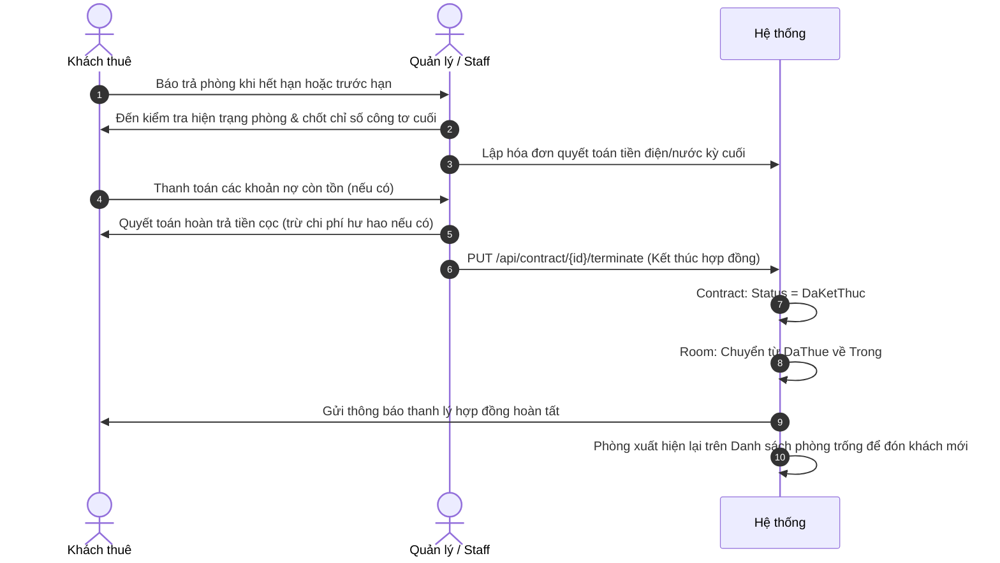
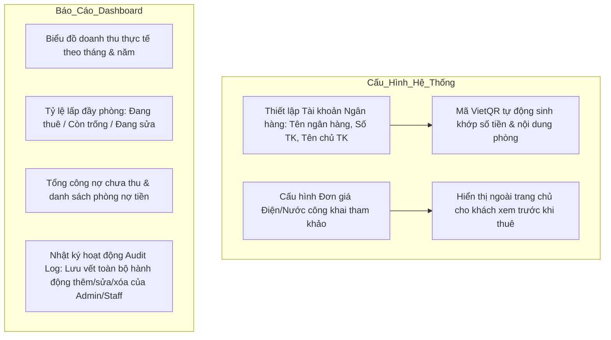

# TÀI LIỆU CÁC LUỒNG HOẠT ĐỘNG HỆ THỐNG QUẢN LÝ NHÀ TRỌ & CHUNG CƯ MINI (TROHUB)

> **Phiên bản:** 2.0  
> **Kiến trúc:** Frontend (React + TypeScript + Tailwind CSS) · Backend (ASP.NET Core Web API + EF Core + SQL Server) · Xác thực (JWT Bearer)

---

## MỤC LỤC
1. [Tổng quan hệ thống & Ma trận phân quyền (RBAC)](#1-tổng-quan-hệ-thống--ma-trận-phân-quyền-rbac)
2. [Vòng đời các thực thể chính (State Machine)](#2-vòng-đời-các-thực-thể-chính-state-machine)
3. [Luồng 1: Xác thực & Đăng nhập (Auth Flow)](#3-luồng-1-xác-thực--đăng-nhập-auth-flow)
4. [Luồng 2: Tìm kiếm & Đăng ký thuê phòng (Room Discovery & Rental Request)](#4-luồng-2-tìm-kiếm--đăng-ký-thuê-phòng-room-discovery--rental-request)
5. [Luồng 3: Duyệt hợp đồng & Đặt cọc giữ phòng (Contract Approval & Deposit)](#5-luồng-3-duyệt-hợp-đồng--đặt-cọc-giữ-phòng-contract-approval--deposit)
6. [Luồng 4: Kích hoạt hợp đồng & Nhận phòng (Contract Activation & Check-in)](#6-luồng-4-kích-hoạt-hợp-đồng--nhận-phòng-contract-activation--check-in)
7. [Luồng 5: Tính tiền & Thu hóa đơn hàng tháng (Monthly Billing & Meter Reading)](#7-luồng-5-tính-tiền--thu-hóa-đơn-hàng-tháng-monthly-billing--meter-reading)
8. [Luồng 6: Yêu cầu bảo trì & Xử lý sự cố (Maintenance Workflow)](#8-luồng-6-yêu-cầu-bảo-trì--xử-lý-sự-cố-maintenance-workflow)
9. [Luồng 7: Kết thúc hợp đồng & Trả phòng (Check-out & Contract Termination)](#9-luồng-7-kết-thúc-hợp-đồng--trả-phòng-check-out--contract-termination)
10. [Luồng 8: Quản trị cấu hình & Báo cáo thống kê (Admin & Dashboard)](#10-luồng-8-quản-trị-cấu-hình--báo-cáo-thống-kê-admin--dashboard)

---

## 1. TỔNG QUAN HỆ THỐNG & MA TRẬN PHÂN QUYỀN (RBAC)

Hệ thống phục vụ 3 nhóm đối tượng người dùng chính cùng khách vãng lai:

| Vai trò (Role) | Ký hiệu | Trách nhiệm chính |
|---|---|---|
| **Khách vãng lai (Guest)** | `Guest` | Xem danh sách phòng trống, tra cứu đơn giá tham khảo, liên hệ chủ trọ, đăng ký tài khoản. |
| **Khách thuê (Tenant)** | `Tenant` | Đăng ký thuê phòng, ký hợp đồng số, thanh toán cọc/hóa đơn hàng tháng qua VietQR, báo hỏng thiết bị, khai báo người ở cùng. |
| **Nhân viên (Staff)** | `Staff` | Ghi chỉ số công tơ điện nước, lập hóa đơn, xác nhận thanh toán tiền mặt/chuyển khoản, tiếp nhận và xử lý bảo trì. |
| **Chủ trọ / Quản trị (Admin)**| `Admin` | Toàn quyền hệ thống: duyệt hợp đồng, quản lý tòa nhà/phòng, phân quyền người dùng, cấu hình VietQR, xem báo cáo doanh thu. |

### Ma trận quyền hạn chi tiết

```
+------------------------------------+-------+--------+-------+-------+
| Tính năng                          | Guest | Tenant | Staff | Admin |
+------------------------------------+-------+--------+-------+-------+
| Xem phòng trống & chi tiết giá     |   V   |   V    |   V   |   V   |
| Đăng ký tài khoản khách thuê       |   V   |   -    |   -   |   -   |
| Tạo yêu cầu thuê phòng & ký số     |   -   |   V    |   -   |   -   |
| Khai báo người ở cùng              |   -   |   V    |   V   |   V   |
| Thanh toán VietQR & xem hóa đơn    |   -   |   V    |   V   |   V   |
| Gửi yêu cầu bảo trì                |   -   |   V    |   -   |   -   |
| Duyệt / từ chối hợp đồng           |   -   |   -    |   V   |   V   |
| Lập hóa đơn đơn lẻ & hàng loạt     |   -   |   -    |   V   |   V   |
| Xác nhận thanh toán tiền mặt/QR    |   -   |   -    |   V   |   V   |
| Phân công & cập nhật bảo trì       |   -   |   -    |   V   |   V   |
| Quản lý Tòa nhà & Phòng            |   -   |   -    |   -   |   V   |
| Phân quyền User (Staff/Tenant)     |   -   |   -    |   -   |   V   |
| Cấu hình VietQR & Đơn giá chung   |   -   |   -    |   -   |   V   |
| Xem Báo cáo Dashboard & Audit Log  |   -   |   -    |   -   |   V   |
+------------------------------------+-------+--------+-------+-------+
```

---

## 2. VÒNG ĐỜI CÁC THỰC THỂ CHÍNH (STATE MACHINE)

### 2.1. Vòng đời Hợp đồng (Contract)


### 2.2. Vòng đời Hóa đơn (Invoice)


### 2.3. Vòng đời Phòng (Room)


### 2.4. Vòng đời Yêu cầu bảo trì (Maintenance Request)


---

## 3. LUỒNG 1: XÁC THỰC & ĐĂNG NHẬP (AUTH FLOW)

### Mục đích:
Xác thực danh tính người dùng qua JWT token, phân quyền truy cập và điều hướng đúng giao diện theo vai trò.



---

## 4. LUỒNG 2: TÌM KIẾM & ĐĂNG KÝ THUÊ PHÒNG

### Mục đích:
Khách hàng khám phá các phòng trống, xem thông số minh bạch (giá phòng, dự tính điện nước), điền thông tin và ký chữ ký số online.



---

## 5. LUỒNG 3: DUYỆT HỢP ĐỒNG & ĐẶT CỌC GIỮ PHÒNG

### Mục đích:
Admin/Staff kiểm tra tính hợp lệ của người thuê, chốt đơn giá điện nước chính thức vào điều khoản hợp đồng và sinh hóa đơn cọc.



---

## 6. LUỒNG 4: KÍCH HOẠT HỢP ĐỒNG & NHẬN PHÒNG

### Mục đích:
Khách hoàn tất nghĩa vụ tiền cọc để kích hoạt hợp đồng hiệu lực và chính thức chuyển trạng thái phòng thành Đã Thuê.

```mermaid
flowchart TD
    A[Khách thuê vào 'Hóa đơn của tôi' / 'Hợp đồng của tôi'] --> B[Mở Hóa đơn cọc trạng thái ChưaThanhToan]
    B --> C{Chọn cách thanh toán}
    C -- Quét VietQR -- D[Hệ thống tạo mã VietQR động theo tài khoản ngân hàng chủ trọ]
    D --> E[Khách quét QR trên Mobile Banking và chuyển khoản đúng nội dung]
    E --> F[Khách gửi xác nhận chuyển khoản trên hệ thống]
    C -- Nộp Tiền mặt -- G[Khách gặp trực tiếp Admin/Staff tại văn phòng]
    F --> H[Admin/Staff kiểm tra tiền về tài khoản hoặc nhận tiền mặt]
    G --> H
    H --> I[Admin bấm Xác nhận thanh toán hóa đơn cọc]
    I --> J[Hóa đơn cọc: DaThanhToan]
    J --> K[Hợp đồng: Chuyển sang DangHieuLuc]
    K --> L[Phòng: Tự động chuyển từ Trong sang DaThue]
    L --> M[Khách thuê nhận phòng & có thể Khai báo danh sách người ở cùng]
```

---

## 7. LUỒNG 5: TÍNH TIỀN & THU HÓA ĐƠN HÀNG THÁNG

### Mục đích:
Tính toán tiền phòng, tiền điện, tiền nước định kỳ theo chỉ số công tơ thực tế và gửi thông báo thu tiền tự động.

### Công thức tính toán hệ thống:
$$\text{Tiền điện} = (\text{Chỉ số điện mới} - \text{Chỉ số điện cũ}) \times \text{Đơn giá điện hợp đồng}$$
$$\text{Tiền nước} = (\text{Chỉ số nước mới} - \text{Chỉ số nước cũ}) \times \text{Đơn giá nước hợp đồng}$$
$$\text{Tổng hóa đơn} = \text{Tiền phòng} + \text{Tiền điện} + \text{Tiền nước} + \text{Phí dịch vụ khác}$$



### Xử lý quá hạn & nhắc nợ:
- Hóa đơn quá hạn nộp sẽ tự chuyển / đánh dấu `QuaHan`.
- Admin/Staff có thể bấm nút **Nhắc nợ quá hạn** hoặc **Nhắc sắp đến hạn** trên thanh công cụ để hệ thống tự động bắn Notification hàng loạt tới các phòng chưa đóng tiền.

---

## 8. LUỒNG 6: YÊU CẦU BẢO TRÌ & XỬ LÝ SỰ CỐ

### Mục đích:
Tiếp nhận và giải quyết nhanh chóng các phản ánh hư hỏng thiết bị (điều hòa, bình nóng lạnh, bóng đèn, khóa cửa,...) của khách thuê.

```mermaid
flowchart LR
    subgraph Khách_Thuê
        A[Phát hiện sự cố thiết bị] --> B[Gửi Yêu cầu bảo trì: Tiêu đề, Mô tả, Mức độ ưu tiên]
    end

    subgraph Ban_Quản_Lý
        B --> C[Admin/Staff nhận thông báo yêu cầu mới]
        C --> D[Phân công nhân viên kỹ thuật phụ trách]
        D --> E[Kỹ thuật viên liên hệ khách & đến kiểm tra sửa chữa]
        E --> F{Kết quả sửa chữa}
        F -- Hoàn tất -- G[Cập nhật trạng thái: Hoàn thành + Ghi chú]
        F -- Yêu cầu hủy/sai -- H[Cập nhật trạng thái: Đã hủy]
    end

    subgraph Nghiệm_Thu
        G --> I[Hệ thống gửi thông báo kết quả tới Khách thuê]
        H --> I
    end
```

---

## 9. LUỒNG 7: KẾT THÚC HỢP ĐỒNG & TRẢ PHÒNG

### Mục đích:
Thanh lý hợp đồng an toàn, nghiệm thu bàn giao tài sản phòng, quyết toán tiền cọc và đưa phòng trở lại trạng thái sẵn sàng cho thuê mới.



---

## 10. LUỒNG 8: QUẢN TRỊ CẤU HÌNH & BÁO CÁO THỐNG KÊ

### Mục đích:
Hỗ trợ chủ trọ quản lý doanh thu minh bạch, theo dõi lịch sử biến động và thiết lập các thông số tự động của toàn hệ thống.



---

## TỔNG KẾT BẢNG MÃ LỖI & QUY TẮC NGHIỆP VỤ ĐẶC THÙ

1. **Ràng buộc một phòng - một hợp đồng hiệu lực:**  
   Một phòng đang ở trạng thái `DaThue` hoặc có hợp đồng `DangHieuLuc` thì không thể tạo thêm hợp đồng hiệu lực mới.
2. **Bảo toàn lịch sử chỉ số công tơ:**  
   Hóa đơn tháng mới bắt buộc có `Số công tơ cũ` $\ge$ `Số công tơ mới của hóa đơn liền trước`.
3. **Chữ ký số pháp lý:**  
   Khách thuê ký trực tiếp trên pad cảm ứng lúc gửi yêu cầu thuê; chữ ký được nhúng vĩnh viễn vào file mẫu Word/PDF hợp đồng.
4. **Cơ chế Theme thông minh:**  
   Hệ thống hỗ trợ cả Light Mode và Dark Mode trên 100% các màn hình quản trị và khách thuê, tự động nhận diện tương phản màu chữ và thanh cuộn bảng dữ liệu chuẩn UX.

